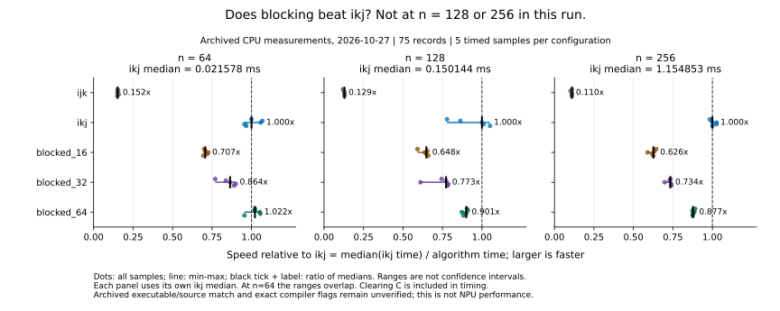
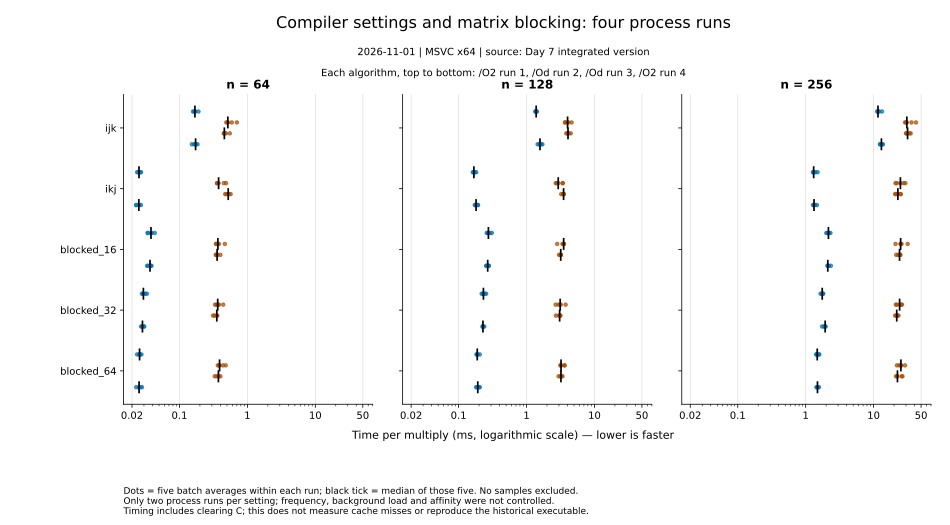

# 第 3 章：分块与编译选项

> 把大矩阵切成小块，让正在用的数据多留在缓存里；再换编译选项复测，确认结论不是优化选项造成的。

## 本章收获
写出带边界处理的分块矩阵乘法并验证它正确，用数据回答"n ≤ 256 时分块有没有变快"，并看到编译选项会怎样改变各个算法之间的对比。

## 知识点地图
1. 分块不改变数学定义：`C00 = A00·B00 + A01·B10`
2. 边界处理：`min(ii + block_size, n)`，以 n = 70、b = 32 为例
3. 分块的收益（数据复用）与成本（循环控制开销）
4. 程序没有崩溃，不等于访问是安全的
5. `/O2` 与 `/Od`：优化选项对不同算法的影响不一样

## 讲义
| 讲义 | 内容 |
|---|---|
| [笔记 06：分块](../journey/notes/06-blocking.md) | 子块怎样参与计算、边界处理、分块的收益和成本 |
| 延伸阅读：Algorithmica [Matrix Multiplication](https://en.algorithmica.org/hpc/algorithms/matmul/) | 属于 C0-R04，在第 5 章读，读完可以回头解释本章的结果 |

## 动手实践

### 任务一：实现分块并验证边界
1. 在 `ikj` 的基础上写 `matmul_blocked(n, block_size)`，每一维都用 `min(..., n)` 处理最后一块
2. 用 n = 70、b = 32 这类不能整除的情况，和参考结果逐元素比较

在仓库根目录运行：
```bash
bash results/tests/smoke.sh
# 观察：blocking-correctness 覆盖了不能整除的情况和非法参数
```

### 任务二：比较三种块大小
n = 64、128、256 × {`ijk`、`ikj`、b = 16、32、64}，每种 5 个样本，取中位数，算分块相对 `ikj` 的耗时变化。

仓库里的程序：[results/src/blocking.cpp](../results/src/blocking.cpp)

### 任务三：换编译选项复测
同一份 `blocking.cpp` 分别用 MSVC `/O2` 和 `/Od` 构建，按 O2、Od、Od、O2 的顺序运行 4 次，每次都做逐元素校验。

思考：`/Od` 下 `ikj` 和 `ijk` 的差距为什么变小了？

### 任务四（支线，选做）：Performance Ninja 分块
做 [memory_bound/loop_tiling_1](https://github.com/dendibakh/perf-ninja/tree/main/labs/memory_bound/loop_tiling_1)。对应战役 C0 的 S02。

## 成果展示
**实验 02：分块 b = 16 / 32 / 64**



**实验 03：编译选项 /O2 vs /Od**



结果表、结论和边界见 [实验 02](../results/experiments/02-blocking/) 和 [实验 03](../results/experiments/03-compiler-flags/)。

## 与后续章节的关系
本章留下两个问题：小规模下分块为什么没有变快（第 4 章先做纸面预测，再把 n 扩大到 2048 验证）；`/O2` 有没有自动向量化 `ikj`（第 5 章用向量化报告和汇编回答）。
