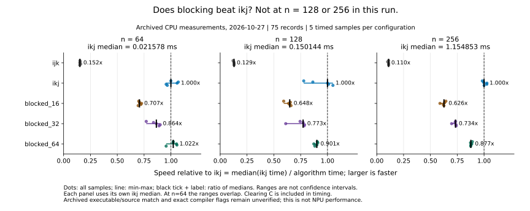

# C++ 矩阵乘法性能分析与分块优化实验

我以 C++ 矩阵乘法为载体，学习如何验证程序正确性、设计性能对照实验，并分析不同实现的运行结果。项目从循环顺序对访存的影响出发，进一步尝试分块计算；实验数据、分析报告和代码保存在仓库中。通过这些工作，我希望逐步理解数据复用，为后续学习 NPU 架构与数据流打下基础。

**快速查看：** [循环顺序源码](src/day05-ijk-ikj-benchmark.cpp) · [分块实现及来源说明](src/day07-matrix-blocking.cpp) · [独立正确性测试](tests/day07-correctness.cpp) · [原始数据](experiments/results/README.md) · [实验报告](experiments/reports/README.md)

## 实验结果

### 循环顺序：`ijk` 与 `ikj`

Day 5 在同一次运行中交替测量两种实现。下表为各组 5 个批次平均耗时的中位数之比；数值仅适用于这次运行、程序和规模。

| 矩阵阶数 n | `ijk` 中位耗时 / `ikj` 中位耗时 |
| ---: | ---: |
| 64 | 6.85× |
| 128 | 8.45× |
| 256 | 9.38× |

`ijk` 内层访问按行存储的 B 时跨行，`ikj` 则沿 B 和 C 的行连续访问；空间局部性提供了一种与结果相符的解释，但总耗时不能单独证明缓存未命中如何变化。[原始数据](experiments/results/2026-10-26-day05-loop-order-local/day05-loop-order-program-export.csv) · [实验报告](experiments/reports/2026-10-26-day05-loop-order.md)

### 分块：与 `ikj` 比较



Day 7 在 128、256 阶下，块大小 16、32、64 的中位耗时均高于 `ikj`。64 阶时 `blocked_64` 与 `ikj` 接近，样本范围重叠，不能仅凭中位数断定稳定加速。图中范围是样本观测范围，不是置信区间。[图表说明](experiments/figures/README.md) · [原始数据](experiments/results/2026-10-27-day07-blocking-local/day07-blocking-program-export.csv) · [实验报告](experiments/reports/2026-10-27-day07-blocking.md)

> 历史测量的完整逐字源码未归档；现行 Day 7 文件是根据学习对话整理的版本。历史计时尚未逐行复现。[来源说明](notes/day07-code-materials.md)

### 编译选项与分块复测

2026-11-01 对现行整合版分别使用 MSVC `/O2` 与 `/Od` 编译，按 O2、Od、Od、O2 顺序在本机各运行两次，共保留 300 条样本。本次 `/O2` 的两轮中，128、256 阶三种分块的中位耗时仍高于同轮 `ikj`；两种编译选项的对应组在本次运行中也有明显差异。频率、负载及亲和性未控制，结果仅供探索，不能把差异全部归因于编译选项。测量由 Codex 按我的请求执行。[完整数据与环境](experiments/results/2026-11-01-compiler-blocking-windows/metadata.md) · [分析报告](experiments/reports/2026-11-01-compiler-blocking-windows.md)

## 实验方法与限制

- **正确性**：Day 5 使用 `ijk` 试测结果作为逐元素比较的参考，另检查 `C[0][0]` 的预期值和校验和。每个正式批次校验最后一次计算结果，并非每次重复都单独校验。
- **测量**：矩阵阶数为 64、128、256；每种配置在每一轮运行中有 5 个正式批次。Day 5 交替改变 `ijk` 和 `ikj` 的先后顺序；单批内重复计算，记录平均耗时，再比较批次中位数。
- **计时范围**：包含 C 清零和矩阵乘法；输入初始化、正确性检查及输出在计时之外。保留异常样本，原因不作未经验证的判断。[异常分析](notes/supplements/day04-day05-n128-high-samples.md)
- **边界测试**：历史 Day 7 截图记录 `n=70, block=32` 通过；后续针对现行整合版的独立测试另覆盖 392 个组合，不代表历史计时复现。[测试说明](tests/README.md)
- **环境**：历史 Day 4–7 经补充确认为 Windows、Intel Core Ultra 7 255HX、Visual Studio 2026 18.11.1、Release/x64；历史 MSVC toolset 版本未记录。新复测环境单独记录，不倒填历史参数。
- **分析边界**：测得的总耗时不能直接证明 cache miss、带宽或具体瓶颈的变化。Day 8 学习了缓存、带宽与延迟、IPC/CPI、计数范围和对照实验设计；其中示例数据来自教学场景，没有真实硬件计数器采集。[Day 8 笔记](notes/day08-notes.md)

## 目录与复现

```text
src/                 当前程序（注意各文件来源说明）
code_history/        历史版本快照
experiments/results/  分实验归档的原始数据与环境
experiments/reports/ 实验分析报告
experiments/figures/ 可重建图表
notes/               学习、补充和维护记录
tests/               构建与独立正确性检查
```

Windows 上打开 Visual Studio 的 **x64 Native Tools Command Prompt**，在仓库根目录运行：

```bat
if not exist build mkdir build
cl /nologo /std:c++17 /EHsc /O2 /utf-8 tests\day07-correctness.cpp /Fe:build\day07-correctness.exe /Fo:build\day07-correctness.obj
build\day07-correctness.exe
python experiments\summarize_medians.py
```

第一项检查现行整合版的正确性，第二项只读取历史 CSV 并重新计算中位数；两者都不重跑历史性能测量。[更多构建与运行说明](tests/README.md)

## 进度与下一步

- [x] 小矩阵、逐元素对照与边界检查；循环顺序和分块实验。
- [x] 归档原始样本、分析异常并保留分块未加速的结果。
- [x] 对现行整合版进行编译选项与分块复测（执行与限制见报告）。
- [ ] 在记录频率、负载和亲和性等条件后增加独立运行轮次，继续分析分块与编译优化。
- [ ] 学习 SIMD 与向量化；探索脉动阵列及数据流的软件建模。软件模型与真实 NPU 硬件测试分开记录。

更详细的学习过程与材料缺口见 [项目状态](PROJECT_STATE.md)。
