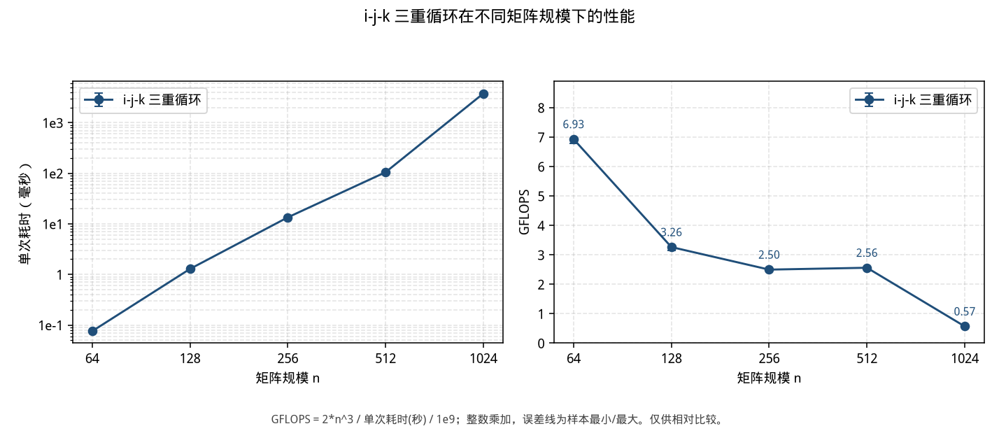

# cpp-matmul-performance

[](https://github.com/lingquan11/cpp-matmul-performance/actions/workflows/bench.yml)

用可复现的 C++ 计时，看朴素矩阵乘法在规模变大以后，耗时为什么不跟着运算次数走，从而理解数据复用为什么对 NPU 重要。

我是东南大学电子信息专业大一。

## 当前做到哪

i-j-k 基线我已经做完了。`src/day02_matrix.cpp` 是固定 2×2，输出 `11 10` 和 `19 30`。2026-10-26 我在云端 VM 上把同一种实现从 n=64 测到 1024，每个规模 5 个正式样本。这是 i-j-k 的规模扫描，不是循环重排、分块或 SCALE-Sim。

下一步我打算先加另一种循环顺序，和 i-j-k 放在同一张图上，再在同一口径下做分块，然后看脉动阵列和 SCALE-Sim。

眼下的安排以 [`PROJECT_STATE.md`](PROJECT_STATE.md) 为准。

## 怎么跑

```bash
python3 benchmarks/run_bench.py
```

需要 `g++` 和 Python 3。画图需要 `matplotlib`；没有安装时这条命令会尝试安装。默认规模 64、128、256、512、1024，每个规模 5 个正式样本，输出到 `results/<日期>_matmul/`。

脚本会把 `benchmarks/kernels/` 里的实现画在同一张图上，现在里面是 i-j-k。循环重排或分块放进这个目录之后，还是跑同一条命令，步骤在 [`benchmarks/README.md`](benchmarks/README.md)。

推送到 `main` 时，上面的徽章会编译并跑一次 n=64，只检查能否通过，不更新图。

## 结果在哪

n=1024 的 GFLOPS 是 **0.569162**，约为 n=64（6.929414）的 8.2%。数字来自 2026-10-26 04:05 UTC 那次云端 VM 运行，只适合看这次实验内部的相对关系。口径、环境和能说的分析在 [规模扫描实验记录](reports/2026-10-26-ijk-scale.md)。



| 规模 n | 单次耗时中位数 (ms) | GFLOPS |
| ---: | ---: | ---: |
| 64 | 0.075661 | 6.929414 |
| 128 | 1.285246 | 3.263424 |
| 256 | 13.434294 | 2.497670 |
| 512 | 104.810185 | 2.561158 |
| 1024 | 3773.059512 | 0.569162 |

原始样本在 [`results/2026-10-26_ijk-scale/raw.csv`](results/2026-10-26_ijk-scale/raw.csv)。报告都从 [`reports/`](reports/README.md) 进入。

## 笔记在哪

学习笔记在 [`notes/`](notes/README.md)：

- 理解笔记 `dayNN-notes.md`
- 每日归档 `dayNN-record.md`
- 每天的流水 [`notes/daily-task-records.md`](notes/daily-task-records.md)

## 目录

| 路径 | 里面是什么 |
| --- | --- |
| [`src/`](src/README.md) | 已有的学习程序（Day 1 单元素，Day 2 的 2×2） |
| [`benchmarks/`](benchmarks/README.md) | 计时驱动。`kernels/` 放要上图的实现 |
| [`results/`](results/README.md) | 实测 CSV 和图 |
| [`notes/`](notes/README.md) | 每日学习记录和理解笔记 |
| [`reports/`](reports/README.md) | 实验记录与阶段报告（唯一报告入口） |
| [`PROJECT_STATE.md`](PROJECT_STATE.md) | 当前状态。和本页不一致时，以它为准 |

<details>
<summary>协作备忘（看成果可以跳过）</summary>

2026-10-25 确认的范围和教学约定在 [`handoff/2026-10-25-项目变更与协作同步报告.md`](handoff/2026-10-25-项目变更与协作同步报告.md)。那是给后续协作者的决定记录，不是实验结论。

</details>
