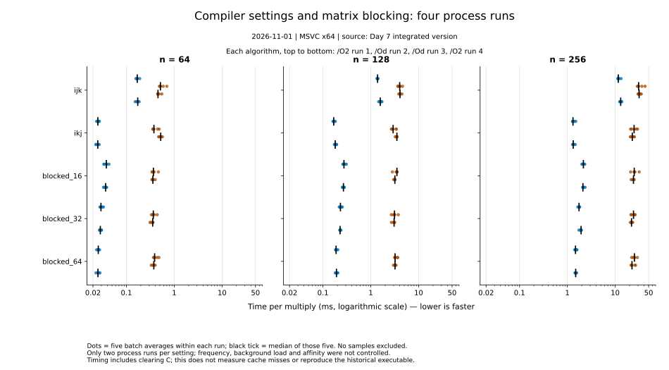

# Day 7：分块是否比 ikj 更快？


图使用 [2026-10-27 原始 CSV](../results/2026-10-27-day07-blocking-local/day07-blocking-program-export.csv) 的全部 75 条记录，没有新增测量或删除样本。每个面板对应一个矩阵尺寸；点为五次正式样本，横线为观测范围，黑色短线和数字为中位数之比。范围不是置信区间，五次样本也不代表五台机器。

横轴为同尺寸 `ikj` 中位耗时除以待比较算法耗时，越大越快；虚线 1 表示 `ikj` 的中位数。点使用单次耗时作分母，黑色短线和数字使用各算法中位耗时作分母，**不是逐次配对比值的中位数**。每个面板的基准不同，绝对耗时见面板标题与 [汇总 CSV](day07-summary.csv)。

应关注的结论：

- `ikj` 比 `ijk` 快；同轮中位耗时之比约为 6.58×、7.74×、9.06×。
- 在这次测试的三种分块中，`blocked_64` 中位耗时最低。128、256 阶时，它仍比 `ikj` 慢约 11.0%、14.0%。
- 64 阶时 `blocked_64` 中位耗时低约 2.1%，但样本范围重叠，不能据此断言它稳定更快。

## 如何重新生成

在仓库根目录，安装有 Python 3.10+ 与 Matplotlib 的环境中运行：

```text
python scripts/summarize_day07.py
```

本次使用 Python 和 Matplotlib 的实际版本保存在 [来源记录](day07-provenance.json)。若缺少绘图库，可在自己的虚拟环境安装 `python -m pip install matplotlib==3.10.0`。这项依赖仅用于画图，不影响 C++ 构建或正确性测试。

脚本检查记录数、配置与样本编号、重复样本、PASS/YES、C00、同尺寸校验和一致性、正数且有限的耗时，以及 `total_ms / repeats` 与导出耗时的舍入一致性。它核对的是 CSV 结构与内部一致性，不证明历史测量过程或所有矩阵元素独立正确。检查失败时不跳过记录。

产物为 `day07-summary.csv`、`day07-speedup.svg`、`day07-provenance.json`。重生成会替换这三个派生文件；不会修改原始 CSV。可先输出到临时目录比对：

```text
python scripts/summarize_day07.py --output-dir build/day07-figures
```

来源记录包含原始 CSV 与脚本 SHA-256，便于识别输入和生成器。SVG 不写入生成时间，图元 ID 固定；字体采用 DejaVu Sans 文本，显示效果仍受浏览器字体环境影响。跨 Python/Matplotlib 版本不承诺逐字节相同。

## 能解释到哪里

原始环境补充记录为 Windows、Intel Core Ultra 7 255HX、Visual Studio 2026 18.11.1、Release / x64，见 [环境补充](../../notes/supplements/experiment-environment.md)。原始 MSVC toolset 和具体优化选项未记录，不能把 IDE 版本当成编译器版本。计时包含结果矩阵清零与乘法，不含输入构造和结果检查。

现行 [Day 7 整合源码](../../src/day07-matrix-blocking.cpp) 使用固定容量 `int[256][256]`、物理行跨度 256、没有显式并行；在常见 MSVC/GCC 目标上 `int` 为 32 位。它是 GPT 整合版，**不能因此证明历史执行文件与当前源码、布局或构建选项逐字一致**。原始 CSV 的精确源码对应关系仍未验证。

这里的速度差既不证明 cache miss 降低，也不表示真实 NPU 性能。分析原文继续保存在 [Day 7 报告](../reports/2026-10-27-day07-blocking.md)。当前图表只是让已有证据更容易比较，不替代后续受控测量。

## 2026-11-01 编译选项与分块复测



三面板分别为 n=64、128、256；每种算法依次显示 `/O2`、`/Od`、`/Od`、`/O2` 四次独立进程运行。圆点为该轮五个批次的平均耗时（可能重叠），黑色短线为五个批次的中位数；不是置信区间。横轴为每次乘法的毫秒数，采用对数刻度，数值越小越快。四轮共 300 条，未排除任何样本；每种编译选项只有两次进程运行，不应把批次视为独立进程重复。

数据见[原始 CSV 与环境](../results/2026-11-01-compiler-blocking-windows/metadata.md)，绝对中位数见[实验报告](../reports/2026-11-01-compiler-blocking-windows.md)。频率、温度、后台负载和 CPU 亲和性未控制；无硬件计数器数据，不能据此断言缓存机制或复现历史可执行文件。

安装 Python 3 和 Matplotlib 后，在仓库根目录运行 `python scripts/plot-compiler-blocking.py` 可从四份原始 CSV 重建 SVG；脚本验证每组样本数、状态和耗时有效性，不会修改原始 CSV。图表使用 Matplotlib 3.10.0 生成，不保证跨版本逐字节相同。
