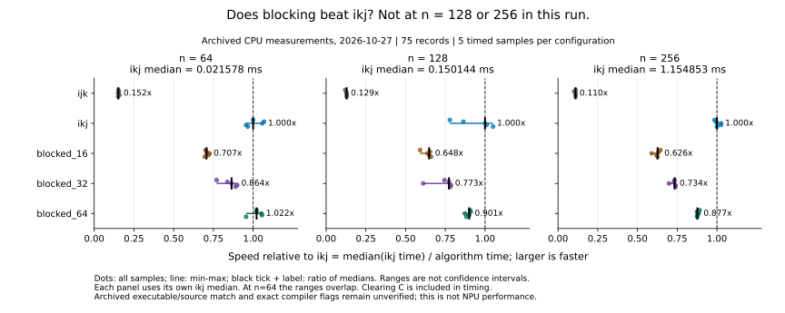
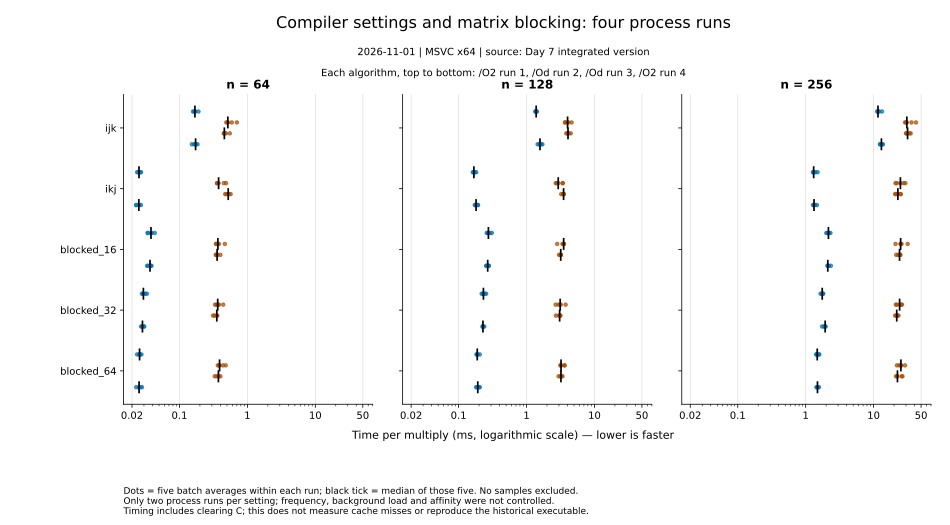

# 第 3 章：分块与编译选项

> 把大矩阵切成小块，让正在用的数据多留在缓存里；再换编译选项复测，确认结论不是优化选项造成的。

## 要点
- 分块不改变数学定义：`C00 = A00·B00 + A01·B10`
- 边界处理：每一维用 `min(ii + block_size, n)` 处理最后一块，以 n = 70、b = 32 为例
- 分块的收益是数据复用，成本是更多的循环控制
- 程序没有崩溃，不等于访问是安全的
- `/O2` 与 `/Od`：优化选项对不同算法的影响不一样

## 讲义
- [我的笔记：分块](notes/blocking.md)：Day 7 讲子块怎样参与计算、边界处理、分块的收益和成本
- 延伸：Algorithmica [Matrix Multiplication](https://en.algorithmica.org/hpc/algorithms/matmul/)（战役 C0 的 R04，第 5 章读，读完可以回头解释本章的结果）

## 练习
1. **实现分块并验证边界**：在 `ikj` 的基础上写 `matmul_blocked(n, block_size)`，用 n = 70、b = 32 这类不能整除的情况和参考结果逐元素比较。仓库里的 `bash results/tests/smoke.sh` 覆盖了这类情况和非法参数
2. **比较三种块大小**：n = 64、128、256 × {`ijk`、`ikj`、b = 16、32、64}，每种 5 个样本，取中位数，算分块相对 `ikj` 的耗时变化。参考程序：[results/src/blocking.cpp](../results/src/blocking.cpp)
3. **换编译选项复测**：同一份 `blocking.cpp` 分别用 MSVC `/O2` 和 `/Od` 构建，按 O2、Od、Od、O2 的顺序运行 4 次，每次都做逐元素校验。思考：`/Od` 下 `ikj` 和 `ijk` 的差距为什么变小了？
4. **选做**：Performance Ninja [memory_bound/loop_tiling_1](https://github.com/dendibakh/perf-ninja/tree/main/labs/memory_bound/loop_tiling_1)

## 成果：实验 02、03
- [实验 02](../results/experiments/02-blocking/)：n = 128、256 时分块比 `ikj` 慢 11–60%，块越小越慢；n = 64、b = 64 基本持平

  
- [实验 03](../results/experiments/03-compiler-flags/)：`/O2` 下分块仍慢于 `ikj`；`/Od` 下所有配置都明显变慢，`ikj` 和 `ijk` 的差距大幅缩小

  

## 留下的问题
- 小规模下分块为什么没有变快？→ [第 4 章](04-perf-diagnosis.md)先做纸面预测，再把 n 扩大到 2048 验证
- `/O2` 有没有自动向量化 `ikj`？→ [第 5 章](05-simd.md)用向量化报告和汇编回答
