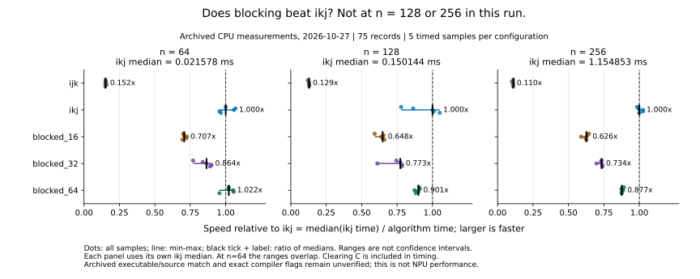

# 02 分块：小规模下没有加速

**问题**：在 `ikj` 的基础上分块（块大小 b = 16 / 32 / 64），能不能更快？

**做法**：`int` 方阵，n = 64 / 128 / 256；`ijk`、`ikj` 和三种分块各 5 个样本，取 `ms_per_multiply` 的中位数。75 条全部通过逐元素校验，另有 n = 70、b = 32 的边界测试。

## 结果（分块相对 ikj 的中位数耗时变化，正数表示更慢）
| n | ikj 中位数 (ms) | b = 16 | b = 32 | b = 64 |
|---:|---:|---:|---:|---:|
| 64 | 0.021578 | +41.4% | +15.7% | −2.1% |
| 128 | 0.150144 | +54.3% | +29.4% | +11.0% |
| 256 | 1.154853 | +59.6% | +36.2% | +14.0% |

**结论**：n ≤ 256 时分块没有带来加速，块越小越慢。n = 64、b = 64 与 `ikj` 基本持平（样本范围重叠）。原因假设：这个规模下整个工作集都能放进缓存，分块只增加了循环开销（在 04 规模扫描中验证）。

## 边界
- 程序是根据学习对话整理的 GPT 整合版，不是当时本机运行的逐字源码
- 只测到 n = 256；只有耗时，没有硬件计数器

## 数据与复现
- 原始数据：[data/blocking.csv](data/blocking.csv)，汇总：[data/summary.csv](data/summary.csv)，环境：[metadata.md](metadata.md)
- 程序：[results/src/blocking.cpp](../../src/blocking.cpp)；作图：`python3 results/scripts/plot-blocking.py`（需要 matplotlib）
