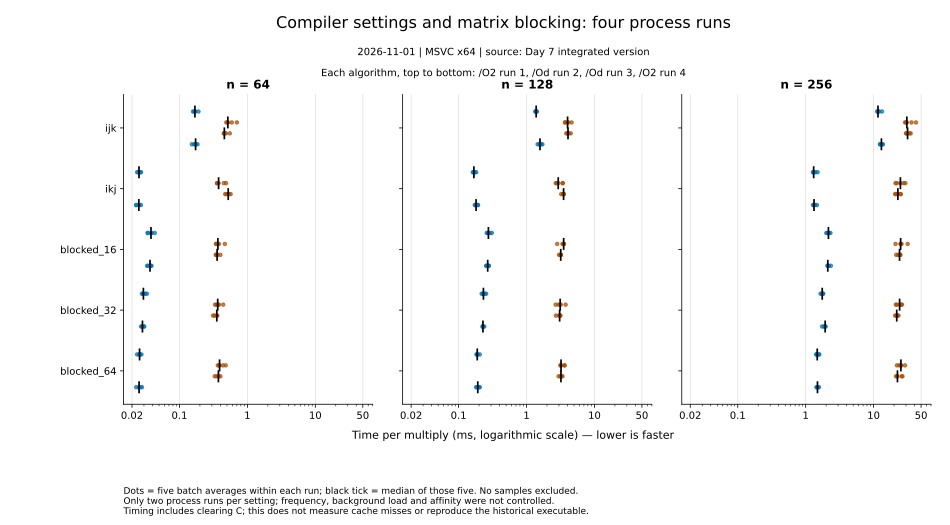

# 03 编译选项：/O2 vs /Od

**问题**：换成 `/O2` 优化后，02 中"分块不加速"的结论还成立吗？优化选项本身影响多大？

**做法**：同一份 `blocking.cpp`，MSVC 分别用 `/O2` 和 `/Od` 构建，按 O2、Od、Od、O2 顺序运行 4 次，每次 75 条，共 300 条，全部通过逐元素校验。表中是每次运行内 5 个批次的中位数。

## 结果（n = 256，ms）
| 算法 | 第 1 轮 /O2 | 第 2 轮 /Od | 第 3 轮 /Od | 第 4 轮 /O2 |
|---|---:|---:|---:|---:|
| ijk | 11.605525 | 30.871325 | 31.627375 | 13.034925 |
| ikj | 1.311551 | 24.826940 | 22.779040 | 1.326341 |
| blocked_64 | 1.480290 | 25.243020 | 22.457640 | 1.492861 |

**结论**：`/O2` 下，128 和 256 阶的三种分块仍然都慢于 `ikj`，与 02 一致。`/Od` 下所有配置都明显变慢，`ikj`（22.8–24.8 ms）与 `ijk`（30.9–31.6 ms）的差距大幅缩小。完整的 n = 64 / 128 / 256 数据见 [data/](data/)。

## 边界
- 只有 4 次运行，调度、频率、温度没有控制，耗时差不能全部归因于编译选项
- 没有查看生成的汇编，不能断定差异来自向量化（留给 05 SIMD）
- 测量由 Codex 按我的要求执行

## 数据与复现
- 原始数据：[data/](data/)（4 个 CSV），环境与命令：[metadata.md](metadata.md)
- 作图：`python3 results/scripts/plot-compiler-flags.py`（需要 matplotlib）
